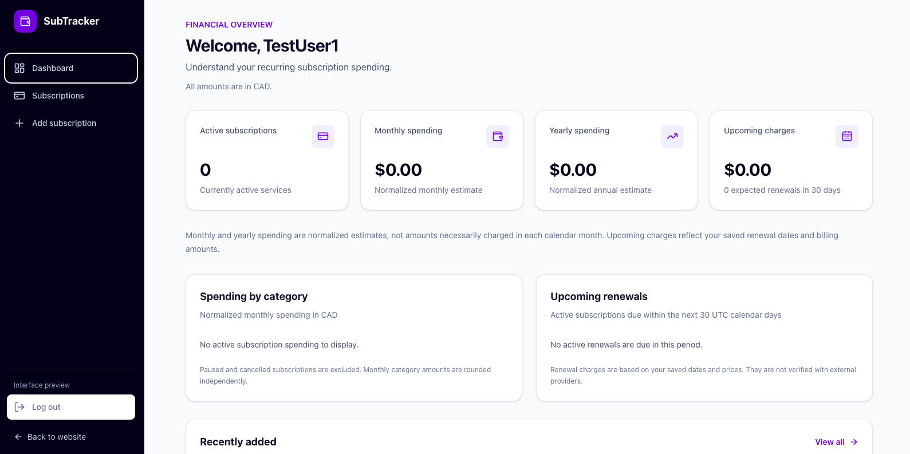
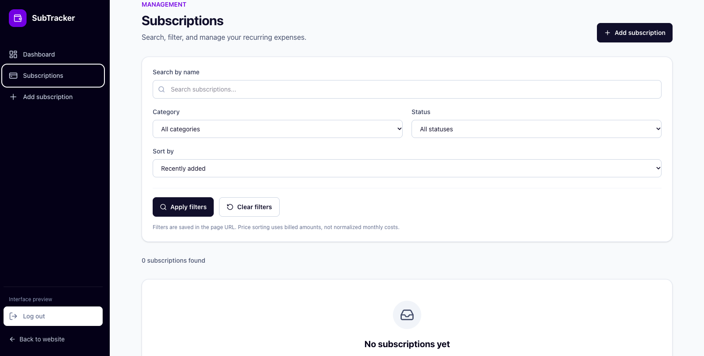

# Subscription Tracker

A full-stack subscription management application built to help users organize recurring payments, monitor subscription expenses, and keep track of upcoming billing dates.

Built with **Next.js 16, TypeScript, Tailwind CSS 4, Prisma 7, Neon PostgreSQL, and Better Auth**.

## Live Demo

**[View the Live Application](https://subscription-tracker-omega-sandy.vercel.app/)**

Create an account to explore the dashboard and manage your own subscriptions.

## Screenshots

### Dashboard



### Subscription Management



## Features

### Authentication and Security

- User registration, login, and logout
- Authentication powered by Better Auth
- Protected dashboard and subscription routes
- Secure session management
- Server-side authorization for subscription operations
- User-specific data isolation

### Subscription Management

- Add new subscriptions
- View all saved subscriptions
- Edit subscription details
- Delete subscriptions with confirmation
- Track subscription price and billing cycle
- Organize subscriptions by category
- Manage subscription status
- Search, filter, and sort subscription records

### Dashboard and Expense Tracking

- Overview of subscription spending
- Recurring cost summaries
- Upcoming payment information
- Subscription statistics
- Updated dashboard information after subscription changes

### User Experience

- Responsive design for desktop and mobile
- Clear forms with input validation
- Loading states and error messages
- Empty states for new users
- Accessible labels and navigation
- Custom application favicon

## Tech Stack

| Category                     | Technology              |
| ---------------------------- | ----------------------- |
| Framework                    | Next.js 16 — App Router |
| Language                     | TypeScript              |
| Styling                      | Tailwind CSS 4          |
| Database                     | PostgreSQL — Neon       |
| ORM                          | Prisma 7                |
| Authentication               | Better Auth             |
| Validation                   | Zod                     |
| Unit and Integration Testing | Vitest                  |
| End-to-End Testing           | Playwright              |
| Deployment                   | Vercel                  |
| CI and Database Migrations   | GitHub Actions          |
| Version Control              | Git and GitHub          |

## Application Routes

| Route                      | Description                      |
| -------------------------- | -------------------------------- |
| `/`                        | Public landing page              |
| `/register`                | Create a new account             |
| `/login`                   | Sign in                          |
| `/dashboard`               | Protected subscription dashboard |
| `/subscriptions`           | View and manage subscriptions    |
| `/subscriptions/new`       | Create a subscription            |
| `/subscriptions/[id]/edit` | Edit an existing subscription    |

Dashboard and subscription routes require an authenticated user.

## Architecture

Subscription Tracker uses the Next.js App Router to organize the application into public pages, authentication pages, and protected application routes.

The application separates user interface components, subscription business logic, authentication, and database access.

### Frontend

Next.js and React provide the application interface. Tailwind CSS is used for responsive layouts, navigation, forms, and dashboard components.

### Backend

Next.js Server Actions and server-side functions handle subscription operations, validation, and data access.

### Authentication

Better Auth manages account registration, login, logout, and authentication sessions.

Protected routes and server-side operations verify the authenticated user before accessing subscription data.

### Database

Neon PostgreSQL stores application data. Prisma provides type-safe database access and versioned schema migrations.

### Deployment

Vercel hosts the Next.js application. Neon provides the production PostgreSQL database, and GitHub Actions supports controlled production migration execution.

## Getting Started

Follow these instructions to run the application locally.

### Prerequisites

- Node.js 24
- npm
- Git
- A PostgreSQL database (Neon recommended)

### 1. Clone the Repository

```bash
git clone https://github.com/divineconnect135/subscription-tracker.git
cd subscription-tracker
```

### 2. Install Dependencies

```bash
npm install
```

### 3. Configure Environment Variables

Create a `.env` file in the project root.

```env
DATABASE_URL="your-neon-pooled-database-url"
DATABASE_URL_UNPOOLED="your-neon-direct-database-url"

BETTER_AUTH_SECRET="your-generated-local-secret"
BETTER_AUTH_URL="http://localhost:3000"
```

**Database connection strings**

- `DATABASE_URL`: The pooled Neon PostgreSQL connection string used by the application.
- `DATABASE_URL_UNPOOLED`: The direct Neon PostgreSQL connection string used by Prisma migrations.

Use a development database or Neon development branch when running locally.

Generate a secure authentication secret:

```bash
node -e 'console.log(require("node:crypto").randomBytes(32).toString("hex"))'
```

Copy the generated value into `BETTER_AUTH_SECRET`.

**Security:** Never commit `.env` files, database credentials, or authentication secrets to GitHub.

### 4. Set Up the Database

Generate the Prisma Client:

```bash
npx prisma generate
```

Apply the existing database migrations:

```bash
npx prisma migrate deploy
```

These commands use the database environment variables configured for the current environment.

### 5. Start the Development Server

```bash
npm run dev
```

Open **http://localhost:3000** in your browser.

You can now register an account, sign in, and start managing subscriptions.

## Testing and Quality Assurance

The project includes automated testing and static checks to help maintain application reliability.

### Linting

```bash
npm run lint
```

### TypeScript Type Checking

```bash
npx tsc --noEmit
```

### Unit and Integration Tests

```bash
npx vitest run
```

### End-to-End Tests

End-to-end tests use Playwright to verify key application workflows.

Configure the project's isolated E2E test database and environment before running these tests. Do not use the production database for testing.

```bash
npx playwright test
```

The E2E coverage includes authentication, subscription management, and checks that users cannot access other users' subscription records.

### Production Build

```bash
npm run build
```

Run these checks before merging or deploying significant changes.

## Production Deployment

The application is deployed using **Vercel** and **Neon PostgreSQL**.

### Vercel Configuration

Import the GitHub repository into Vercel with the Next.js framework preset.

Configure the following production environment variables:

| Variable                | Purpose                                    |
| ----------------------- | ------------------------------------------ |
| `DATABASE_URL`          | Neon production pooled database URL        |
| `DATABASE_URL_UNPOOLED` | Neon production direct database URL        |
| `BETTER_AUTH_SECRET`    | Dedicated production authentication secret |
| `BETTER_AUTH_URL`       | Stable HTTPS production application URL    |

Use a different `BETTER_AUTH_SECRET` for production than for local development or automated testing.

The `BETTER_AUTH_URL` value must match the stable production domain used to access the application.

### Database Migrations

Prisma migrations are version-controlled in the `prisma/migrations` directory.

A GitHub Actions workflow is available at:

`.github/workflows/production-migrations.yml`

The workflow allows production migrations to be applied separately using:

```bash
npx prisma migrate deploy
```

Production credentials are stored as GitHub Actions secrets rather than in source control.

### Continuous Deployment

The Vercel project is connected to the GitHub repository.

Changes pushed to the production branch (`main`) trigger a new Vercel production deployment.

## Security Considerations

The application implements several safeguards:

- Authentication is required for protected application routes.
- Subscription queries and mutations are scoped to the authenticated user.
- Server-side validation is applied to submitted subscription data.
- Users are prevented from accessing subscription records belonging to other accounts.
- Database credentials and authentication secrets are kept in environment variables.
- Development, E2E testing, and production use separate database environments.
- Production database migrations are executed through a dedicated workflow.

The application does not store payment card information or process subscription payments.

## Current Scope

Subscription Tracker is a subscription organization and expense-tracking tool.

It does not connect directly to subscription providers, cancel real-world subscriptions, or process payments.

Subscription records are entered and managed by users within the application.

## Possible Future Improvements

- Optional reminders for upcoming payments
- Additional spending analytics and visualizations
- Exporting subscription data
- Customizable dashboard preferences
- More advanced recurring expense reports

## Project Status

**Deployed — Final Portfolio Polish**

Core authentication, subscription management, dashboard functionality, and production deployment have been implemented.

Final documentation, usability checks, and production verification are being completed.

## Author

**Divine Code**

GitHub: [divineconnect135](https://github.com/divineconnect135)

---

_Built as a full-stack portfolio project to demonstrate modern Next.js development, database integration, authentication, testing, and production deployment._
